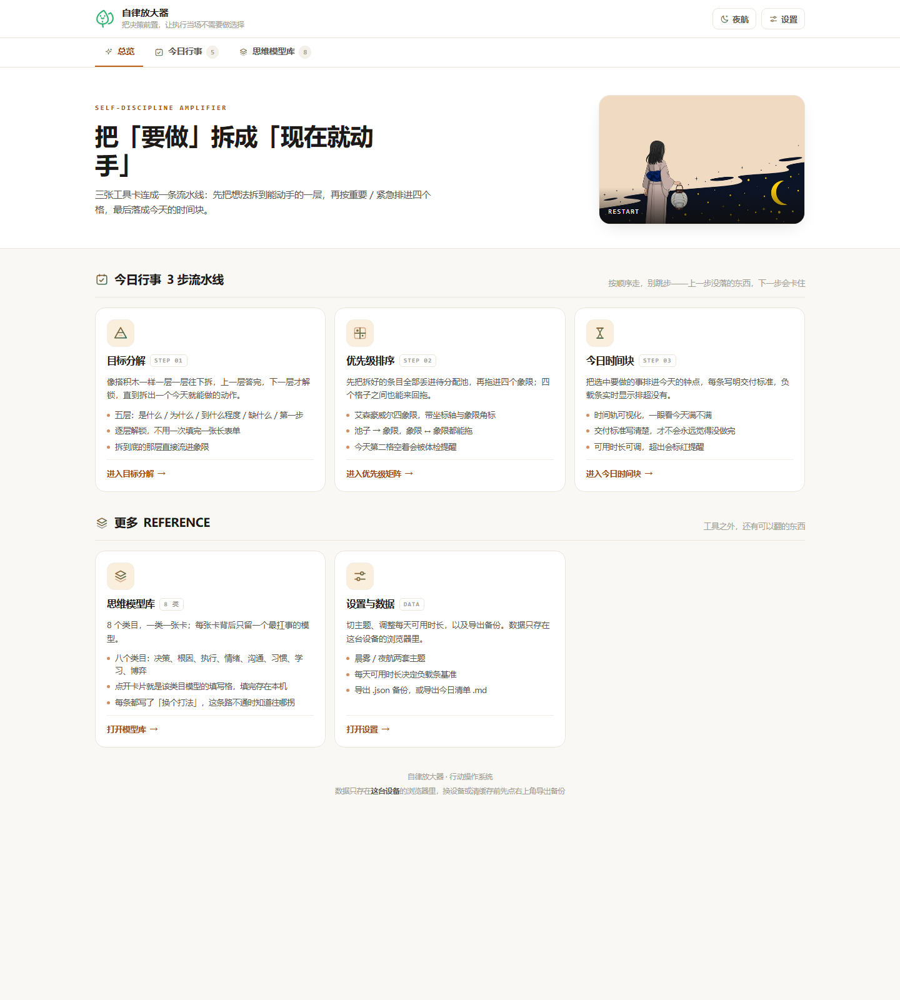
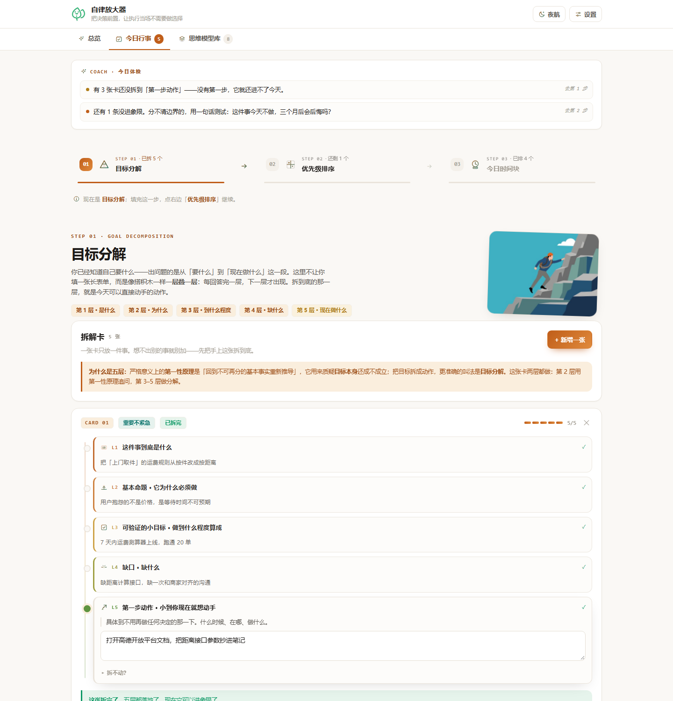
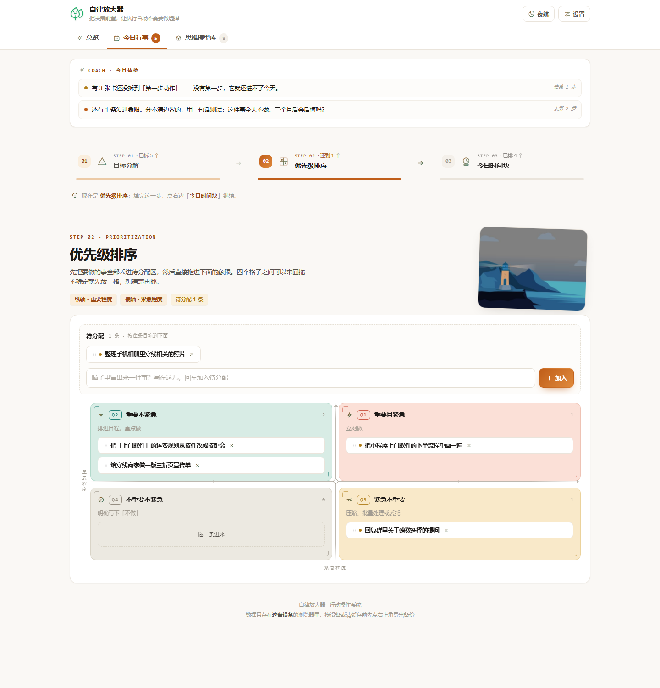
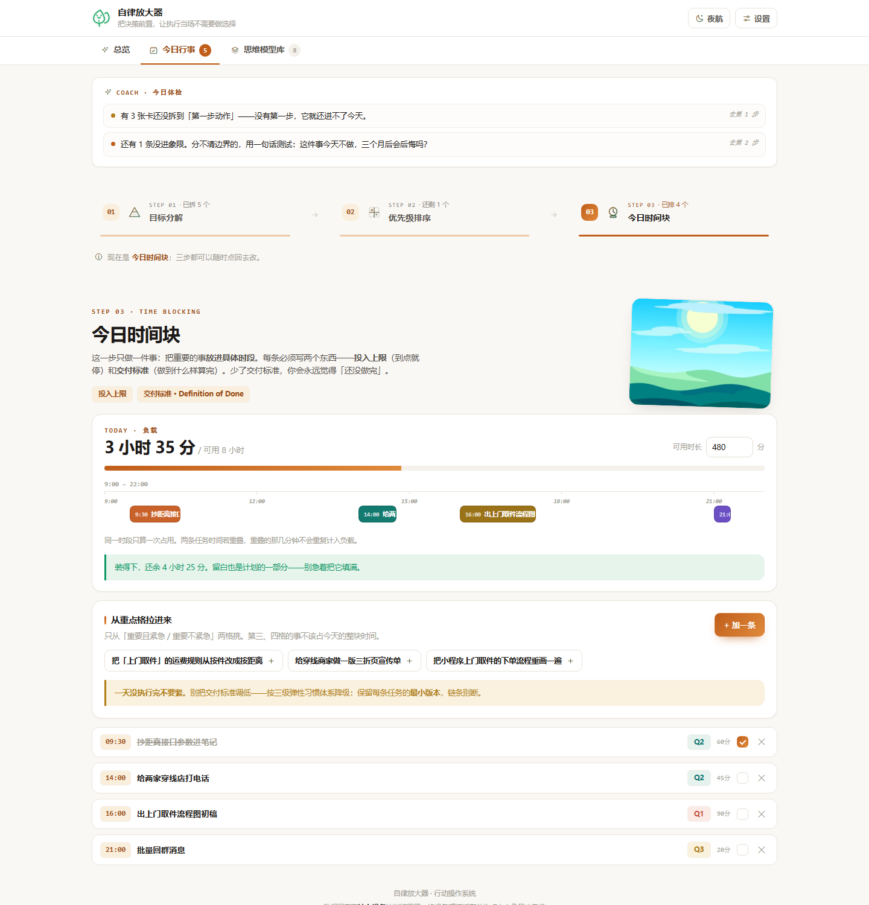
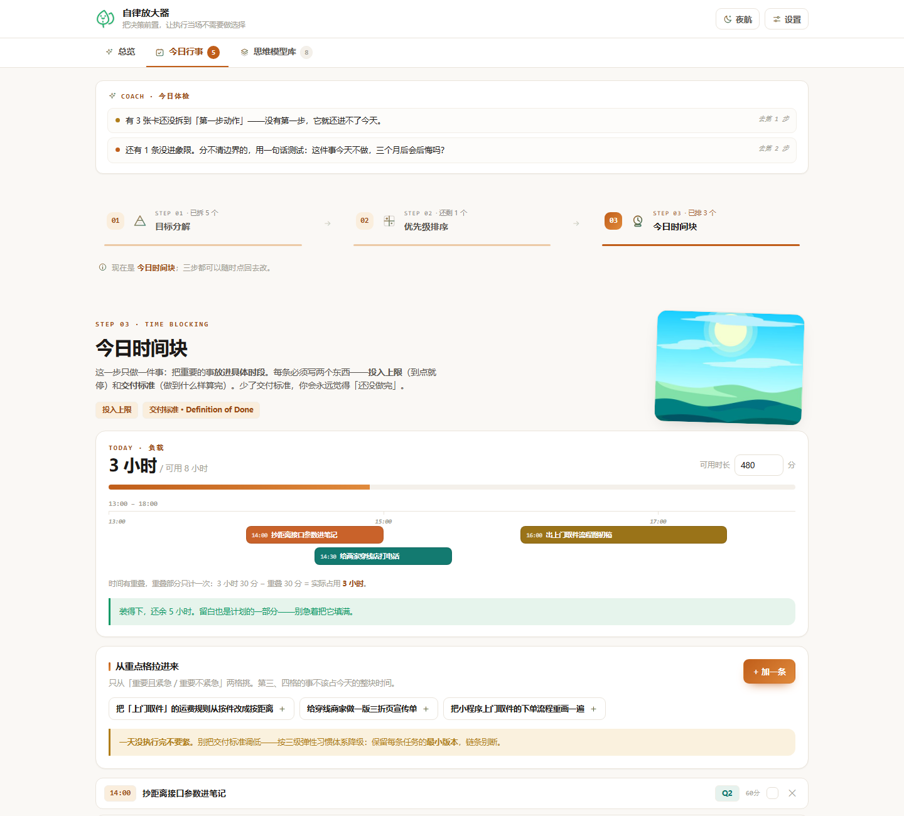
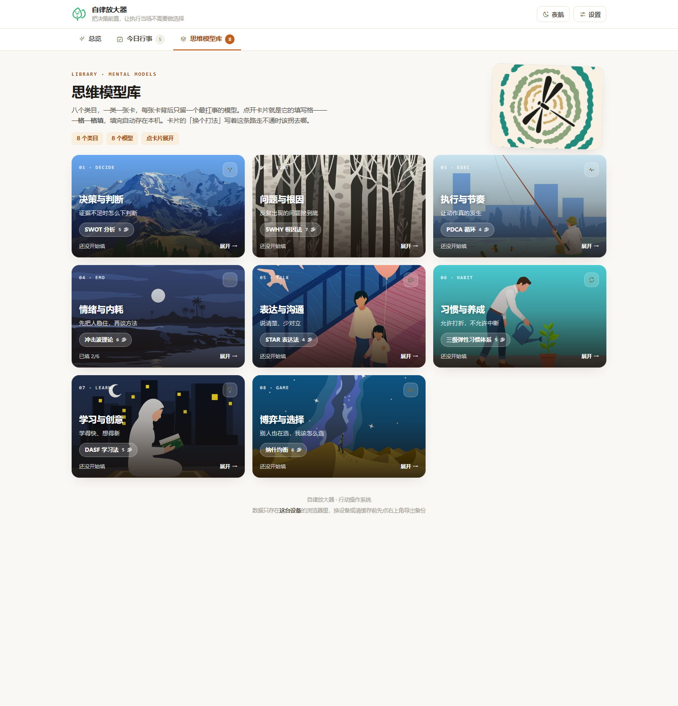
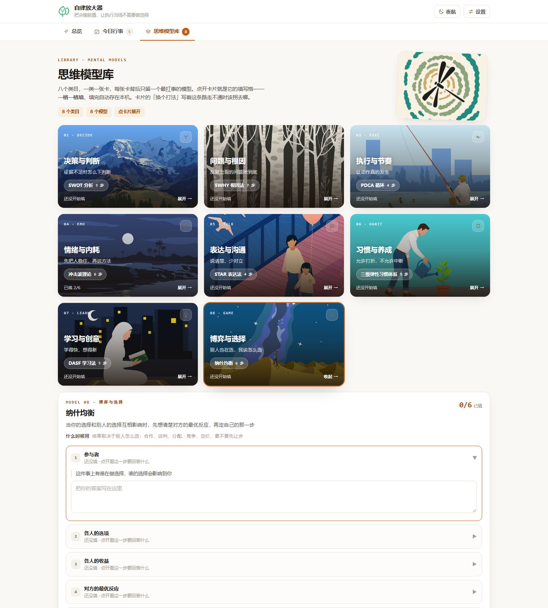
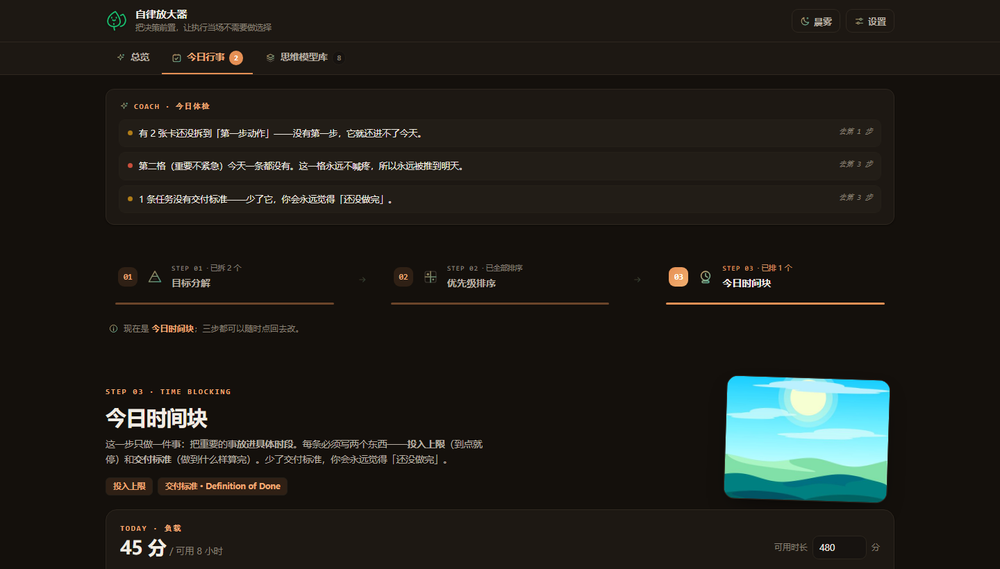
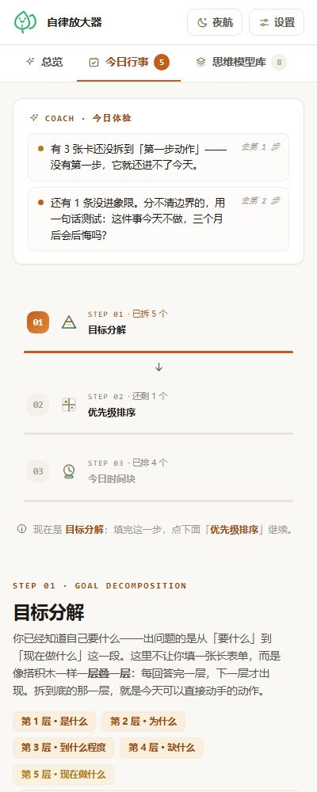

# 自律放大器 · 行动操作系统

一个把「想做的事」压成「今天就能动手的一步」的单文件网页应用。

整个程序只有 **`index.html` 一个文件**。下载它，双击，就能用 —— 不用装环境、不用连服务器、断网照样跑，你的数据只存在你自己电脑的浏览器里。

---

## 立即使用

**方式零：在线直接用（不用下载）**

👉 **https://13297466993.github.io/self-discipline-amplifier/**

打开就能用，手机上也能开。数据存在**你自己的浏览器**里，不会上传到这台服务器。
（想长期留存数据，建议还是用下面的方式下载到本地，或定期在「设置」里导出备份。）

另外三种下载到本地的方式，任选一种：

**方式一：只下一个文件（最快）**

打开 [`index.html`](index.html) → 点右上角 `Raw` → 右键「另存为」→ 双击打开。

**方式二：克隆整个仓库**

```bash
git clone https://github.com/13297466993/self-discipline-amplifier.git
cd self-discipline-amplifier
# 双击 index.html 即可
```

**方式三：打包下载**

在 GitHub 仓库页点 `Code` → `Download ZIP` → 解压 → 双击 `index.html`。

> 推荐把 `index.html` 放到一个固定文件夹（比如「我的工具」），然后发个快捷方式到桌面，当成普通软件用。

---

## 它解决什么问题

很多人不是缺目标，是卡在这三件事上：目标太大不知道从哪下手、事情太多不知道先做哪个、排进了日程但最后一天下来还是空的。

这个应用把过程固定成三步，一步一件事：

| 步骤 | 要回答的问题 | 背后的模型 |
|---|---|---|
| **01 目标分解** | 这件事到底能拆成几个今天可做的动作？ | 第一性原理追问 |
| **02 优先级排序** | 拆出来的这些，先做哪个、哪个可以不做？ | 艾森豪威尔矩阵 |
| **03 今日时间块** | 选中的事排进几点？做到什么程度算完成？ | SMART + 交付标准 |

### 三个模块

**每日行事** —— 上面那三步。上一层的条目没处理完，下一层不会给你看，避免一上来就被满屏内容吓退。

**思维模型库** —— 八个类目，一类一张卡，每张卡背后只留一个最扛事的模型，点开就是可直接填写的格子：

| 类目 | 展开的模型 |
|---|---|
| 决策与判断 | SWOT 分析 |
| 问题与根因 | 5WHY |
| 执行与节奏 | PDCA |
| 情绪与内耗 | 冲击波理论 |
| 表达与沟通 | STAR 表达法 |
| 习惯与养成 | 三级弹性习惯法 |
| 学习与创意 | DASF 学习法 |
| 博弈与选择 | 纳什均衡 |

每条都写了「换个打法」—— 这条路走不通时，告诉你该往哪拐。

**统计回顾** —— 完成率、连续天数、负载分布，用来看自己是不是又在骗自己。

---

## 界面

<table>
<tr>
<td width="50%"><br><sub>首页 · 工具目录</sub></td>
<td width="50%"><br><sub>第 1 步 · 目标分解</sub></td>
</tr>
<tr>
<td width="50%"><br><sub>第 2 步 · 优先级矩阵（四象限可拖拽）</sub></td>
<td width="50%"><br><sub>第 3 步 · 今日时间块</sub></td>
</tr>
</table>

### 时间轴会自动错行分色

重叠的任务会自动排到不同行、染成不同颜色，一眼看出哪段时间撞车了。



**重叠的时间只计一次。** 比如 14:00–15:00 和 14:30–15:30 两条任务，负载记 90 分钟而不是 120 分钟 —— 否则用总时长减任务时长会算出负数。界面上会写明「重叠 30 分钟，已合并」。

### 思维模型库



点开任意一张卡，展开该类目的模型填写格：



### 深色模式与移动端

<table>
<tr>
<td width="50%"><br><sub>深色模式</sub></td>
<td width="33%"><br><sub>400px 窄屏（三步改竖排）</sub></td>
</tr>
</table>

---

## 你的数据在哪

**只在你自己这台电脑上。** 所有内容存在浏览器的 `localStorage`（键名 `zeyu-self-amplifier-v2`）里：

- 不联网、不上传、没有账号、没有后端；
- 换浏览器、换电脑、清理浏览器数据会看不到原来的内容 —— 这是本地存储的固有特性；
- 想备份：应用内「设置」里有导出，存成文件放好，换机器再导入即可。

> 注意：无痕 / 隐私模式下关闭窗口后数据会被清除，别在无痕窗口里认真填。

---

## 技术说明

- **单文件、零依赖**：HTML / CSS / JavaScript 全部写在 `index.html` 里，插图和图标都是内嵌的 base64，外部资源引用数为 **0**。
- **纯前端**：没有构建步骤，没有 npm 包，改完刷新页面即生效。
- **数据层**：`localStorage`，键名 `zeyu-self-amplifier-v2`。
- **响应式**：1416 / 1000 / 744 / 400 四档宽度实测无横向溢出；窄屏下三步自动改竖排。
- **主题**：浅色 / 深色，跟随系统设置，也可在「设置」里手动切换。

仓库里 `assets/` 是插图与图标的构建脚本，`screenshots/` 是界面截图，**都不是运行必需的** —— 只拿 `index.html` 就够了。

---

## 常见问题

**双击打开后是空白 / 报错？**
确认下载的是完整的 `index.html`（约 450 KB），而不是 GitHub 的预览页 HTML。请务必从 `Raw` 链接或 `Download ZIP` 获取。

**换台电脑怎么看原来的数据？**
在原来那台机器上「设置」→ 导出，把文件带到新机器导入。数据不会自动同步。

**能多人共用吗？**
不能。它是单机工具，数据跟着浏览器走，没有协作功能。

**手机上能用吗？**
能。浏览器打开即可，窄屏会自动适配。但手机浏览器对 `localStorage` 的清理策略比较激进，重要内容建议定期导出备份。

---

## 许可

MIT License。随便用、随便改，注明出处即可。
